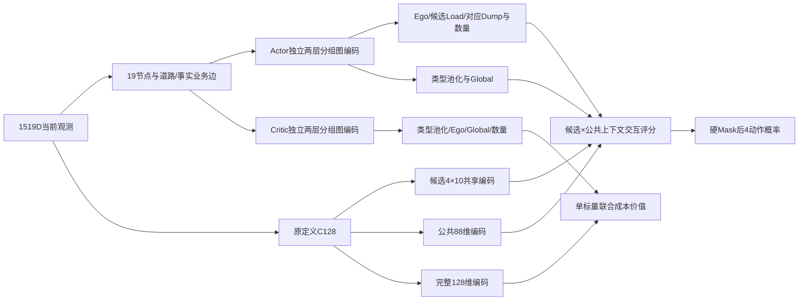

# 19 节点业务图与 C128 融合

以混合训练 Full S02 为对照的 [BG128 整班 REINFORCE 训练包](reinforce_comparison_001/README.md) 使用共同 u0、相同的 1,024 班工况顺序和 Tang 式（19）的移动平均基线。

论文立项入口见 [动态配矿图强化学习研究定义书 V1.0](research_definition_v1_001/README.md) 和 [BG128 数学架构定义](research_definition_v1_001/architecture_math.md)。

现场应用见 [巴润西采场数据接入与卸载去向决策](site_data_integration_001/README.md)。

当前实验（2026-11-19）为 [首窗单动作反事实](first_window_action_001/README.md)。固定 3e-4/u13，先复现两条首窗失败轨迹，再在各自证书前执行一次合法替代。

当前研究（2026-11-18）：[首窗物料兑现、图/C128利用与PPO后期机制](next_stage_mechanism_001/README.md)首轮离线诊断已完成，见[证据报告](../../../reports/token_attention_001/business_graph_summary_009/next_stage_mechanism_001/README.md)。保留3e-4/u13，不新增物理班次；早期动作反事实与后期Checkpoint独立性能仍待验证。

已完成：[原共同u0与相同训练/推理种子的Actor低学习率对照](optimization_stability_001/README.md)，512训练和100班同种子新u13推理均已完成；3e-4/1e-4完整任务98%/92%，低学习率成本和等待增加，完整结果见方案入口。

2026-11-18，Asia/Shanghai。承接用户确定的“图表征＋128D摘要”方案。实现包为 `business_graph_summary_v1`，候选身份为 `s01_BG128`。本页保留架构设计及最初离线验收范围。精确字段/尺度见 [schema.json](schema.json)，工程证据见 [验收报告](../../../reports/token_attention_001/business_graph_summary_009/README.md)。

最新运行状态：已完成[单随机种子正式训练](formal_training_001/README.md)的512班和16次更新，以及预选checkpoint13的[100班独立推理](checkpoint_evaluation_001/README.md)。完整任务率98%、矿/废达产率均100%。后续[综合分析](../../../reports/token_attention_001/business_graph_summary_009/trained_analysis_001/README.md)覆盖reward、收敛、梯度、首窗失败与[训练后A/B/C干预](../../../reports/token_attention_001/business_graph_summary_009/trained_intervention_001/audit_report.md)，离线分析未新增班次或更新模型。

历史32班只读构图及相邻决策审计见 [历史快照方案](historical_snapshot_001/README.md) 与 [两张快照、变化图和Reward审计](../../../reports/token_attention_001/business_graph_summary_009/historical_snapshot_001/audit_report.md)。本次覆盖5841个有效决策，模型Forward/参数更新/新班次均为0，与此前包含合成模型更新的工程验收分开记录。

随后按用户授权完成 [相邻快照编码器追踪](encoder_snapshot_001/README.md) 与 [数值传播报告](../../../reports/token_attention_001/business_graph_summary_009/encoder_snapshot_001/audit_report.md)：固定随机初始化，保存Actor/Critic各自T0/T1的H0/H1/H2，审计Truck→Dump→Load路径和表示变化来源。该轮有无梯度Forward，优化更新与新班次均为0，不将数值变化解释为已学习业务语义。

## 1. 表征与信息边界

保留 `dispatch.physical.v3` 的原始1519D观测、现有C128定义及其原始观测字节证书。Actor和Critic分别编码，不共享参数。32 Token改为19 Token：Truck0..8、Load0..3、Dump0..1、Junction2/3/4、Global；每个64D。道路从独立Token改为16条有向属性边。地图锚定Load=[5,6,7,8]、Dump=[0,1]、Junction=[2,3,4]，校验当前冻结的实际16路端点顺序。站点已经充当地理端点，不再增加重复站点锚定Token。

道路保留长度、限速、关闭状态、当前观测segment引用的车辆数。该计数不是传感器级完整占用真值。连续边属性同时参与消息内容和注意力打分。车辆有序路径、当前路段、前车、运动历史和站点FIFO原有内容路径保留；中间节点编码汇聚其进出道路与在节点车辆。Global从原始前19维编码，单独旁路，不冒充已经整合整个图的全局表示。

本次不引入未来真实ETA、未来品位或已实现成本作为输入。原C128的名义到达/窗口投影仍是基于当前状态的估计，保留valid/uncertainty字段。载货车辆历史装载来源若原观测未给出，不重建为事实边。

## 2. 事实业务边与候选读取

|关系|事实来源|方向与含义|
|---|---|---|
|预留装载|非决策车辆的loadTarget及reservedLoadTons|Truck→Load传承诺；反向传站点条件|
|已载卸载目标|loaded与dumpTarget|Truck→Dump传实际载荷；反向传处理压力|
|排队/占用/服务/容量等待/准入|站点原始车辆ID列表|每类独立关系，反向类型独立|
|物料兼容|Load物料与Dump接收类型|Load→Dump表达兼容供给，反向表达下游压力|
|交通定位|真实道路与Truck的节点/segment/predecessor|保留方向、位置和有效性|

候选关系通过四个直接读出索引表达：Ego与候选Load及兼容Dump进入同一共享评分网络。四个候选不作为四份已派发任务注入事实图，也不增加任何预留吨位或在途车辆数。最终合法性仍由原始action mask硬约束；非法候选对应的实体保留在图与池化中。

queue/seize/capacityWait保留原始槽位顺序；service按成员及实例处理，不将ID排列当作服务先后。同一Truck可能有多个业务关系，不按节点对简单去重。各业务数量采用明确集合/目标口径，目标、排队和服务数量分别报告，不把它们相加成重复的承诺吨位。

## 3. 两层关系分组聚合与数量通道

关系按transport、commitment、service、material分组。每个接收节点在每一组内部独立softmax，再将各组消息及存在标志拼接融合；缺失组消息严格为零，自身信息由残差保留。道路和业务边不共享同一softmax分母。分组能够保持输入通道的区分，不保证训练后每组都被有效利用。

显式数量包括预留/载货目标车辆数与吨位、已知品位质量、站点排队/占用/服务等统计。精确字段与归一化尺度随实现导出到 `schema.json`。这些确定性数量既进入节点编码，也通过站点/类型聚合直接进入Actor和Critic读出，避免全部压缩进LayerNorm后的64D。数量与C128重复时仅作为不同特征视图拼接，不再相加为新的物料总量。

两层可达：`远处待装Truck→Load`、`已载Truck→Dump→Load`。Actor直接消费更新后的Load和Dump，所以不要求所有业务信息额外经Ego中转。有限层数和64D压缩不保证无损，需用路径和输出干预检验。

## 4. 图与 C128 的融合

Actor把原C128分成前88维公共任务上下文与后四组10维候选信息。前88维包含21维全局、23维承诺池、当前/下一窗口各22维；每个候选10维为legal、dispatch_q、ore、grade_mean、grade_std、available_q、queue_count、busy_fraction、nominal_eta、eta_valid。字段顺序冻结。每个候选使用同一个10→16编码器。

公共上下文由四类实体分别池化、Ego、Global、按类型汇总的数量和C_task编码形成；候选向量由Ego、对应Load、兼容Dump、对应数量、mask/tons和该候选C_action编码形成。四个动作共享评分器，显式加入候选与上下文的逐元素乘积/双线性交互，避免只有公共加法项。无额外动作编号嵌入。

Critic保留完整C128→32编码，与自己的类型池化、Ego、Global和数量通道融合，最终输出一个成本价值。真正终止状态V=0。Actor/Critic均无最终Query或跨实体检索模块；图内部的关系注意力保留。



## 5. 同一目标、独立评价、检查点隔离

直接复用008成本定义：四窗deadband=.004、scale=.006、cap=2、空窗2；矿石16000/废石4000吨缺口各权重8；车队等待权重0.2/28800。6000吨是环境废石停派阈值。Critic拟合同成本MC，Actor用同成本及更新前冻结V计算GAE，整体优势统一标准化。PPO默认学习率、clipping、epoch、梯度裁剪等与008相同。

新learner仅更换模型与架构/检查点身份；目标冻结和PPO数值方法与008做AST对照。C缓存证书继续使用原版本，图版本由新graph_contract绑定。检查点与Actor artifact使用独立schema并绑定源文件签名，拒绝旧TQ检查点或静默热启动。

独评复用原指标与分母：四窗RMSE、四窗联合合规率、矿石/废石达产率、完整任务率、累计等待、Critic MC MSE、pooled Explained Variance。附新表征身份，不把随机初始化的梯度通道或历史轨迹上的forward当作新模型性能结果。

## 6. 最初离线验收与当时的运行边界

离线验收覆盖事实边、方向、缺失ID、候选与承诺分离、数量去重、队列顺序、service置换、组内归一与缺失组、连续属性梯度、候选/摘要交互、mask/terminal、独立参数、相同MC/GAE、完整synthetic更新与精确恢复。另读取历史真实决策检查兼容性，仅做新模型随机初始化forward，不训练历史独评数据。

最初离线工程阶段完成了模型、学习器、检查点与独评接口，当时没有新的recording_id、运行目录或班次预留，也没有编辑ALP。随后真实AnyLogic的phase/admission/controller已按009新身份在上方正式训练与独评专属目录准备。每轮仍需提供独立配置SHA、Python/事件目录及run/seed清单并核对合并预算，不能把新模型直接塞进旧008控制器。

这版同时改变节点表示、分组聚合、C128融合和评分，属于完整工程基线；与历史TQ128的差异不能归因于其中单个模块。组件收益需后续匹配消融。

## 7. 实现规格与一键离线验证

25种有向关系、4个关系组、14维边属性、每节点21维确定性数量。实际GNN的H1/H2均为`[B,19,64]`，Global行保持旁路。组内使用共享源/value变换加关系one-hot与连续边属性条件；组间拼接消息和存在标志后融合，没有额外的group-gate注意力权重。

公共图读出468D（四类均值256＋Ego64＋Global64＋四类数量和84），Actor接C_task32D得到500D上下文输入；每个候选输入273D（Ego/Load/Dump192＋对应三组数量63＋mask/tons2＋C_action16）。候选和上下文各编码64D，评分输入`[candidate,context,candidate*context]`为192D，并加点积`sum(candidate*context)/8`。Critic接完整C128的32D编码后为500D输入，输出1D。Actor260481参数，Critic185297参数，各自图编码器116912参数。Token变少不意味着参数更少；旧TQ128为190321/186033，当前Actor容量更大。

从仓库根目录执行以下命令。输出目录必须是新的，以保留历史证据；仅运行离线测试和历史状态forward，不启动RPC、不登记实验预算：

```bash
/home/jinx/miniconda3/envs/anylogic-env/bin/python -B \
  experiments/lagrangian_ppo_v1/change_plans/token_attention_001/business_graph_summary_009/verify_offline.py \
  --output /tmp/bg009-offline-check
```

入口显式优先导入本实验目录的当前schema，避免仓库根目录同名历史`python`包造成歧义。Actor artifact单独加载也校验封印、配置、架构、实现签名和update_index；独评入口拒绝把旧TQ模型标成BG009。

基于完整混合 `s02/u32` 的 [6–9 车动态出勤与班中退场训练](fleet_outage_resilience_001/README.md)包含 baseline2 手工接线、992 班逐班启动清单和配对评价口径。
