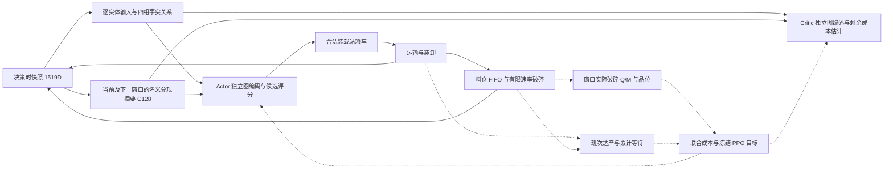

# 动态配矿图强化学习研究定义书 V1.0

截至 2026-11-24，论文所用的消融和对比实验已完成。结题梳理汇总八种策略百班配对、五组结构消融、一层与两层的三种子对照、矿源泛化和物料结算证据。下文保留 11 月 19 日的立项记录。[BG128 论文主线与已完成的实验证据](paper_review_20261124/README.md)

立项方向为固定露天矿场景下的动态配矿与矿卡调度多目标优化，按 SCI 二区方法论文的证据标准组织。研究定义采用综合模式（synthesize），处于实验设计阶段。BG128/u13 的实现、任务口径和历史证据已核定至 2026-11-19。整班联合优化为论文主线，首窗 FIFO 延迟兑现用于解释策略表现。实验端点、对照与推断口径在新实验前预注册。 [数学架构定义与参数清单](architecture_math.md)

## 1. 研究问题与边界

**研究问题。** 在固定矿山拓扑、车队和班次目标下，以实际破碎窗口品位、矿废产量和车队等待为联合目标，使用物理关系与可见物料承诺的调度策略能否在完整班次上取得更好的权衡？冻结策略在同一矿山的未见运输工况下能保留多少收益？首窗重点分析在 FIFO 锁定前哪些派车决策仍能改变窗内实际处理的矿石吨数 $Q$ 与金属吨数 $M$。

中文暂题为《固定矿山场景下基于物理关系图强化学习的动态配矿与矿卡调度多目标优化》。英文暂题为 *Relational Graph Reinforcement Learning for Multi-Objective Dynamic Ore Blending and Truck Dispatching*。

| 任务要素 | 当前约定 |
|---|---|
| 研究对象 | AnyLogic 事件驱动露天矿仿真。一个完整 8 小时班次有四个 2 小时品位窗口。固定 9 辆异型矿卡、4 个装载站、2 个卸载站、3 个路口及 16 条有向道路。 |
| 决策时信息 | 中央调度策略读取当前 1519D 快照、合法掩码与派车量。图和 C128 均从同一快照构造。C128 给出当前/下一窗名义兑现信息和不确定性标志，未来实测结果只用于结算与验证。 |
| 输出 | 每次请求为一辆车选择一个合法装载站，矿废类别映射到对应卸载站。默认评价原 Actor 的随机采样策略。 |
| 目标 | 以实际破碎 $M_w/Q_w$ 评价每窗品位，以实际破碎矿吨和实际卸载废石吨核算达产，累计车队等待。训练按预先固定的标量联合成本用 PPO 更新。 |
| 适用边界 | 固定九车、固定观测合同与地图的仿真。以同一拓扑下的未见物理运输参数检验零样本工况泛化。跨车数、跨地图、跨班次长度和生产实地部署分别属于额外验证范围。 |

当前 RPC 校验要求 `num_trucks == 9`，图的车辆 Token 固定为 9 个。16→24 辆零样本迁移需要先建立可变长观测、实体索引和模型兼容性，再有独立评估证据。它作为后续研究边界，V1.0 的论文主张限于现有接口可验证的范围。 [RPC 车数](../../../../python/reward_config.py#L65) · [观测切分](../../../../business_graph_summary_v1/encoder.py#L81)

## 2. 最接近的工作与可证伪的研究空白

一次派车改变装载来源、载量、在途竞争和到达顺序。卸载进入缓冲仓后，处理能力及 FIFO 在班内窗口间转移实际兑现的吨位和金属量。因此，按时卸载、静态混合品位接近目标和窗口实际破碎品位合规是三个不同的事件。待检验的能力是基于决策时可见的信息，区分会在本窗兑现的承诺、尚未兑现的候选承诺与已入仓物料，并让这种区分转化为策略收益。 [FIFO 核算](../../../../grade_event_memory_v1/events.py#L283) · [首窗失效分析](../../../../reports/token_attention_001/business_graph_summary_009/trained_analysis_001/README.md#L31)

| 角色与文献 | 已处理的任务及证据 | 对 V1.0 的约束 |
|---|---|---|
| 最近对标。Hao Tang 等，*Robust scheduling policy learning for ore-flow blending in dynamic and uncertain environments*，Computers & Operations Research，2026 | 事件驱动配矿，GRU 与 GatedGCN 的时空图策略，使用道路、车流历史和采掘点前瞻，比较了多个矿区、车队规模和扰动。§3.2.5 式 (15)–(16) 对抵达并卸入站点的卡车按累计质量限额聚合滑动窗口品位。 | 时空图强化学习配矿、窗口控制和规模泛化已有明确先例。本文候选区别是卸载之后受能力约束的 FIFO 实际破碎结算、由当前观测派生的可兑现承诺，以及固定物理时窗下的机制检验。两套任务的 RMSE 需在统一结算与信息约束后比较。 [论文全文](https://ktisis.cut.ac.cy/server/api/core/bitstreams/5bacd01e-2593-467f-b7af-50e93f8fc108/content) · [DOI](https://doi.org/10.1016/j.cor.2026.107526) |
| 应用基线。Roberto Noriega、Yashar Pourrahimian、Hooman Askari-Nasab，*Deep Reinforcement Learning based real-time open-pit mining truck dispatching system*，Computers & Operations Research，2025 | 实时 DDQN 派车，在基于运行矿区数据的离散事件仿真中评估矿废产量、品位和设备不确定性。此处定位依据论文摘要。 | “强化学习联合控制产量和品位”已有先例。控制组需共享观察信息、动作边界和物理结算。 [出版论文](https://doi.org/10.1016/j.cor.2024.106815) |
| 方法锚点。Dan Busbridge、Dane Sherburn、Pietro Cavallo、Nils Y. Hammerla，*Relational Graph Attention Networks*，arXiv，2019 | 提出关系内和跨关系归一化的注意力变体，并报告基准上的适用差异。 | 关系注意力属于既有方法。BG128 的具体选择是按业务组归一化，边类型和物理属性进入打分及消息值。其增益由保持边端点不变的关系消融检验。 [作者原文](https://arxiv.org/abs/1904.05811) |
| 邻域对标。Kai Zhang、Xijun Yang、Hui Li，*Intelligent decision-making for mine ventilation systems based on graph neural network and deep reinforcement learning fusion*，Scientific Reports，2026 | 用通风拓扑图与 Actor-Critic 做安全约束下的通风控制，文中报告仿真与现场结果。 | 可借鉴从系统约束到图结构再到实证的叙述逻辑。配矿的材料流、破碎结算和目标需由本研究独立建立。 [论文全文](https://pmc.ncbi.nlm.nih.gov/articles/PMC12914000/) · [DOI](https://doi.org/10.1038/s41598-026-37347-8) |

**主假设。** 可见承诺的窗口兑现摘要与物理业务图联合编码，能在独立完整班次上降低预先固定的联合成本，并满足品位、矿废达产和等待的业务判据。以匹配的图无摘要组与扁平有摘要组检验两种表征的条件增量。若相对任一单视图的整班增益达不到预注册阈值，或任一业务分量突破预定退化幅度，主假设不获支持。首窗证据用于解释整班结果中的物料时序机制。

最强的替代解释是简单扁平策略已经能学到足够的 Q/M 表征，或仅用 FIFO 名义投影的规则就能解释观察到的增益。另一解释是不同参数量、检查点选择或采样模式导致性能差异。核心实验同时检验这些解释。研究贡献限定为以下两项，性能部分留待实证。

1. **处理时点明确的动态配矿建模。** 以固定时间窗内的实际破碎 Q/M 结算，在相同物料日志上比较卸载与破碎的边界差异，并用锁定前局部单动作干预验证个案的可改变性。若两种计算口径在预设时滞条件下始终等效，则该机制的实际重要性受限。
2. **决策时可见的物料承诺与关系表征。** 在同一输入合同下结合四组事实关系、显式物料数量及确定性 C128，并用架构和摘要的正交对照测量其增量。若扁平加摘要或同质图在目标与业务护栏下达到相同行为，图与关系改动的贡献按结果下调。独立图编码作为待验证的结构选择。

## 3. 已有证据及用途

| 证据 | 可用结论与范围 |
|---|---|
| 原 BG128 `3e-4/u13`，正式训练单初始化 512 班、16 更新 | 主基线。首个 100 班独评完整任务 98/100，品位 RMSE 0.003173，平均等待 17,964.94 车辆秒/班。另一个 100 班发现批次为 96/100、0.003107、18,455.55 车辆秒/班。两批矿废均 100/100 达产，所有 6 个失败集中在首窗。两批各自报告，发现批次参与了课题聚焦，确认性主对照另用冻结的新评价样本。 [原独评](../../../../reports/token_attention_001/business_graph_summary_009/trained_analysis_001/README.md#L9) · [发现批次](../../../../reports/token_attention_001/business_graph_summary_009/first_window_action_001/discovery_3e4_001/README.md#L3) |
| 两个锁定前单动作实跑反事实 | 两个原首窗失败均可用一次合法替代修复。两对的四个目标批次都赶上首窗，品位变化同时涉及批次成分及其他批次反馈。替代恰为两个状态的 Actor 众数。结论限于两个被选中的状态。新发现四例含两例候选与众数不同，候选的实际修复效果待验证。 [两对复核](../../../../reports/token_attention_001/business_graph_summary_009/first_window_action_001/followup_001/README.md#L9) · [新四例](../../../../reports/token_attention_001/business_graph_summary_009/first_window_action_001/discovery_3e4_001/README.md#L16) |
| 原 `3e-4` 对低 LR `1e-4` | 同初始化、同训练及评价种子的 100 班配对结果支持保留原主基线。完整任务 98/100 对 92/100，成功率的 McNemar 检验 $p=0.109375$。该试验估计单训练初始化下的学习率差异。 [学习率对照](../../../../reports/token_attention_001/business_graph_summary_009/optimization_stability_001/lr_comparison_001/README.md#L3) |
| 旧 G0/U2/G2 与旧 TQ0/TQ128 | 旧 G0/U2/G2 有图传播对照，其中 U2 为均匀传播，目标口径与 BG128 有别。旧 TQ0/TQ128 的同种子 100 班评估中，摘要组品位误差下降、完整任务率增加 24 个百分点，同时废石达产率下降 14 个百分点、等待增加约 0.75 车辆小时/班。它们为假设和护栏提供先验，BG128 上的增量仍待匹配对照。 [旧图传播协议](../../formal_005/protocol.md) · [旧摘要试验](../../../../reports/token_attention_001/single_critic_task_query_008/post_training_analysis_001/README.md#L24) |
| BG128 张量、输入扰动、梯度与离线物理分支 | 确认可用的传递路径、分支独立性、输入敏感性与先验机制。已有 1250 t/h 离线扰动，正式训练覆盖 2500 t/h。架构实现与固定策略的行为变化可复核，策略普适增益与独立重训仍待检验。 [训练后机制分析](../../../../reports/token_attention_001/business_graph_summary_009/trained_analysis_001/README.md#L90) |

## 4. H1–H4 与最小实验矩阵

保留现有 BG128 的两层四头 GAT、实体类型、四个业务组、单标量成本 Critic 与 PPO。新增实现限于可归因的对照开关。将 H3 作为论文主假设，H1 提供图归因，H2 提供分支归因，H4 描述适用范围。工程上先完成共用对照与指标口径，再让同一对照池支撑 H1/H3，按资源安排 H2 与 H4。

| 假设 | 匹配干预与判据 | 当前状态 |
|---|---|---|
| H1 实体图和业务关系的增量 | 同样的派车时信息、C128 条件和候选语义下，先比较扁平 MLP 与同质 GAT，估计实体化与图传播的组合效应。再比较同质 GAT 与关系 GAT，保留端点、边实例、连续属性、数量特征和读取，移除关系 one-hot 及分组归一化，估计关系处理的组合增量。报告容量差异及匹配容量的敏感性。 | 旧候选提供先验。现 BG128 同协议两项对照待做。 |
| H2 独立编码与共享编码 | 固定关系图、C128、两侧读取头、目标及评价规则。对照为一个共享 `GraphStateEncoder` 与两套独立编码器。事前定义共享梯度合成、损失尺度、优化器状态和更新频次。报告原生差异，并在容量控制下判断方向是否保持。直接绑定权重少 116,912 个可训练参数。 | 参数独立已核定，性能差异待检验。 |
| H3 图与 C128 的条件增量 | 重训扁平/关系图 × 关闭/开启 C128 的四格。关闭 C128 保持相同原始快照和事实图，用固定消融入口保持下游宽度，推理时置零只记录为敏感性。以整班联合成本衡量主要效果，同时报告完整任务率、四窗品位、矿废达产及等待。首窗品位和 $Q/M$ 用于机制解释。若要归因到承诺本身，预先定义须移除的 C128 承诺/FIFO 投影字段块，保留全局、进度等其他特征并重训。 | 旧 TQ 已有摘要效应。现 BG128 的四格效应和局部字段归因待做。 |
| H4 固定拓扑下的零样本工况泛化 | 同样 9 辆车、四窗制度和业务目标，冻结全模型与最强匹配对照，先测试训练未见的两级运输工况。预先定义扰动、检查点规则和业务端点，比较各档绝对绩效及相对各自标称场景的退化。 | 已有离线物理扰动。速度扰动的闭环策略证据待做。 |

共用六个待定对照臂为 `MLP−C`、`MLP+C`、`同质GAT+C`、`关系GAT−C`、`关系GAT+C`、`共享关系GAT+C`。前五臂的 Actor/Critic 编码器均独立。四格只需前五臂中的四个。若主张独立的“逐个因素”效应，同质/关系对照的关系标签与分组可再各自受控，V1.0 的主 H1 估计它们作为关系建模方案的联合增量。工程实现采用受控新候选，当前正式 BG128 架构合同固定 C128 已启用。 [BG128 摘要合同](../../../../business_graph_summary_v1/models.py#L138)

以 $Y$ 为「越高越好」的完整班次表现，例如负整班联合成本。用 $(Y_{G,C}-Y_{G,0})$ 和 $(Y_{G,C}-Y_{F,C})$ 分别检验全模型对两种单视图的条件改进。若将“互补”写成超加性协同，还须报告交互 $(Y_{G,C}-Y_{G,0})-(Y_{F,C}-Y_{F,0})$ 及其区间。C128 属于同一输入的确定性工程视图。该四格估计表征增益，字段块试验才支持更细的承诺归因。

另在同一接口增加两条无需训练的规则参照，立即品位偏差优先和名义 FIFO 兑现后品位偏差优先。两条规则使用同样合法掩码和可用的产量、等待约束。具体评分及并列规则须在看到确认集前锁定。用于对接 Tang 等工作的直接方法基线，需先核对历史、前瞻信息和结算协议。可先采用同一环境下的作者方法思想对照，并明确适配范围。 [Tang 等实验基线 §5.2](https://ktisis.cut.ac.cy/server/api/core/bitstreams/5bacd01e-2593-467f-b7af-50e93f8fc108/content)

### H4 运输工况设计

建议最小设计为标称工况加两档物理可行、训练未见的速度扰动。第一轴选会在仿真中实际生效的道路限速变化，以便观察变化后的速度上限进入策略输入。也可选择空载/重载物理基准速度，回答策略对不同运输动力学的适应范围。单个实验固定所改变的参数族，保持拓扑、目标、料仓和破碎设定一致。用实际空载/重载行程时间核对扰动是否生效并验证目标可行性。训练中已有的速度随机性属于标称工况，应按训练参数配置划分保留测试工况。更换随机种子提供同工况复现。 [运输时间扰动的配矿对标 §5.1.1](https://doi.org/10.1016/j.cor.2026.107526) · [固定目标下的动力学泛化](https://papers.nips.cc/paper_files/paper/2023/file/7e7b768198d24d883d69704eee57efb0-Paper-Conference.pdf)

以原封存策略和最强匹配基线为主体，在同一组独立测试场景中固定检查点、输入处理和采样规则，各档直接闭环推理。报告整班联合成本、完整任务率、品位、矿废达产和等待，给出班次级区间。对越低越好的损失 $L$，比较各策略的 $L_{\mathrm{扰动}}-L_{\mathrm{标称}}$ 及这一退化差异的区间，同时核对扰动下的绝对绩效。减速可能因单位班次内通过车辆减少而降低队列等待，等待须与行程时间和完成产量一起解释。

现有 1519D 合同容许预声明道路限速、空载基速和重载基速。新的测试工况需独立冻结期望 RPC 字段和场景指纹，逐项核验 AnyLogic 的实际配置，核对实际行程时间及对应观测。C128 后续路段的名义到达估计用固定空载/重载名义速度受观测限速约束，当前在途估计还参照当前车速。因此，改动基速时名义 ETA 与实际行程可出现差距，改动限速时须核对限速是否实际起约束作用。冻结 C128 后把偏差纳入结果解释。 [运行场景字段及校验](../../../../python/runtime_scenario.py#L403) · [C128 道路时间](../../../../grade_commitment_ppo_v1/features.py#L201)

## 5. 冻结评价口径

| 端点 | 报告规则 |
|---|---|
| 联合成本 | 以完整班次汇总固定权重的品位、产量缺口与等待成本，报告总值及三项分解。以物理端点同时检查收益与代价。 |
| 完整任务 | 四窗均有有效品位且在 `[0.26, 0.28]` 内，沿用冻结浮点容差，且班次矿石 ≥16000 t、废石 ≥4000 t。等待作为独立业务指标。 |
| 品位 | 以实际破碎质量加权得到每窗品位。报告首窗品位成本、首窗合规、四窗合规、有效窗口 RMSE/MAE、空窗及超限方向。空窗判违规，并保留在合规分母中。训练死区 `[0.266, 0.274]` 与评价合规区间分别使用。 |
| 生产及等待 | 报告矿废分别达产率、吨位及缺口。6000 t 为废石停派阈值，物理上界 6193 t 单列核对。报告全车队累计等待车辆秒/班和该数除以 9 的每车累计秒/班，均纳入任务失败的完整班次。 |
| 兑现机制 | 对预先定义的状态与时点记录实际卸载、入仓前方量、首次/末次破碎、窗内 $Q/M$、是否以及何时出现 FIFO 证书。名义候选与实跑结果分别记载。证书依据已观测 FIFO 和剩余破碎能力，适用边界与失效前提须随报告保留。 |
| 效率与稳定性 | 以完整班次、更新数和实际转移数报告训练成本，并给出墙钟、参数量与推理延迟。分开呈现测试场景不确定性和训练初始化变异。 |

在确认性数据之前冻结各假设主端点、最小有意义差异、达产/等待可接受退化幅度、训练初始化数、评估班次规模以及多重推断规则。以共同环境与策略采样种子安排同场景配对，独立登记每个实验的运行身份，并按最新合并账本规则明确授权的配对种子复用。相同种子允许两条策略轨迹在动作后分叉。固定训练预算、信息和超参数选择预算，统一检查点规则和推理模式。对同一配对班次保留四窗原始结果，按班次对给出置信区间；训练种子作为上层重复单位，窗和决策不替代班次或训练种子。固定策略可用班次对 bootstrap 和配对二元检验；多个训练种子时另报告逐种子效应和分层区间。完整任务率接近上限时，保留连续品位成本和配对不等结果，避免只由成功率判断。 [现行指标实现](../../../../single_critic_task_query_v1/evaluation.py#L99) · [已有配对区间](../../../../reports/token_attention_001/business_graph_summary_009/optimization_stability_001/lr_comparison_001/README.md#L27)

合并账本以前缀 21799 班为基础，u16–u32 延训与固定独评登记后为 22611 班。所有状态及两类种子按最新入口检查，原 u13 逐槽评估种子的复用授权适用于已冻结延训方案。H2 活动预留为 0。新增班次依据独立授权，启动前提供独立 recording ID、配置字节 SHA256、Python 输出目录、AnyLogic 事件目录和 run/双 seed 清单。当前默认使用 RPC 运行证据，保持配置与 schema 核验及既有记录。 [最新合并预算入口](../training_extension_001/extension_budget.py#L180) · [预算政策](../../../budget_policy_20261109_001/policy.json)

## 6. 论文方法图

图从左到右展示派车时可见的快照、物理关系图与名义摘要、分别编码的策略与价值、合法派车和实际物料反馈。实线为已实施前向与环境过程，虚线为仅训练使用的成本目标。上支输出采样合法动作，下支输出班次剩余成本，闭环由下一派车请求触发。 [数学定义与参数尺寸](architecture_math.md)

论文建议顺序为引言、问题建模、方法、实验协议、结果与机制讨论、结论。结果按主假设和业务端点组织，再呈现结构归因与外推边界。

## 7. 阶段验收与待确认项

| 交付或定义 | 状态 |
|---|---|
| 图关系及消息传递公式 | 已核对。四业务组、25 有向类型、14D 属性、两层四头、组内归一化与 Global 旁路。 |
| Actor/Critic 输入输出、参数与梯度 | 已核对。独立参数、参数量、MC 回归和成本方向 PPO 损失已写入附录。 |
| 论文主线及对照骨架 | 主线为固定矿山下的整班动态配矿多目标优化。H3 检验表示增量，H1/H2 提供结构归因，H4 检验固定拓扑下的未见工况。 |
| 实验协议 | 下一阶段确定各效应阈值、样本规模、共同种子块、对照成本和授权范围，再冻结确认性协议。 |

就绪度按 5 分制记录。清晰度 5，任务输入、输出、物理结算和评价单位已明确。定位 4，已细读最接近的 Tang 等工作，尚需核查更多直接重叠方法。差异性 3，FIFO 实际兑现的定义差异可定位，算法净收益和最强规则对照有待检验。可行性 3，基线已封存，消融对照和新班次资源待落实。可证伪性 4，已定义关键对照及反证条件，阈值与样本量待预注册。方法证据一致性 5，结算、模型与梯度可回指代码，现有结果已按证据范围限定。

待预注册的决策为各主要效果的最小有意义差异、业务端点的容许退化、速度扰动定义、训练初始化数和测试班次规模。任务和数学架构作为后续协议的版本锚点，所有方法增益和工况泛化假设待验证。
